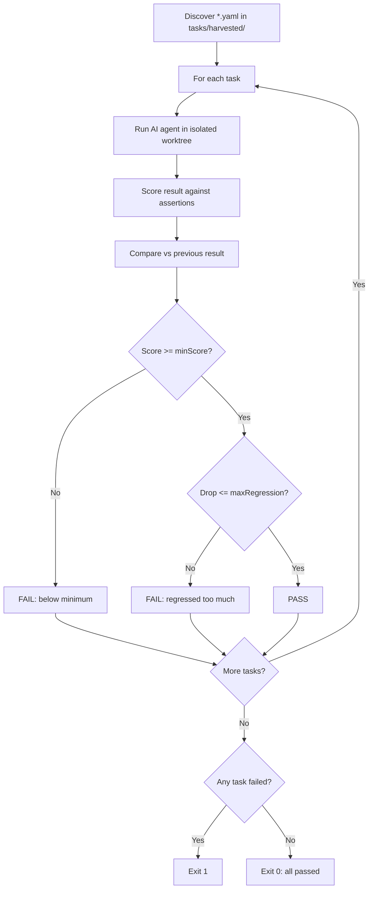

# CI Regression Detection

## Overview

The `ci` command runs all your harvested eval tasks, scores each one, and fails the build if any score drops below a threshold or regresses compared to the previous run. Use it in GitHub Actions, GitLab CI, or any pipeline to catch instruction quality regressions before they merge.

## Quick Start

```bash
# 1. Generate eval tasks from your git history (one-time setup)
agenteval harvest

# 2. Run CI locally to test
agenteval ci

# 3. Add to your GitHub Actions workflow
```

```yaml
# .github/workflows/eval.yml
name: Instruction Quality
on: [pull_request]
jobs:
  eval:
    runs-on: ubuntu-latest
    steps:
      - uses: actions/checkout@v4
        with:
          fetch-depth: 0
      - uses: lukasmetzler/agenteval@v0
        with:
          command: ci
```

The GitHub Action installs agenteval automatically. No Bun or build step needed. `ci` runs a real agent for every task, so the runner also needs the agent CLI installed and its credentials available (or a `--harness` override). `fetch-depth: 0` is needed because harvested tasks start from the parent of their source commit.

You can also lint instruction files on every PR. `--format github` turns each finding into an inline annotation on the diff:

```yaml
      - uses: lukasmetzler/agenteval@v0
        with:
          command: lint
          args: "--severity warning --format github"
```

Or upload SARIF to GitHub code scanning:

```yaml
    permissions:
      security-events: write
    steps:
      - uses: actions/checkout@v4
      - uses: lukasmetzler/agenteval@v0
        with:
          command: --version
      - run: agenteval lint --format sarif > agenteval.sarif || true
      - uses: github/codeql-action/upload-sarif@v3
        with:
          sarif_file: agenteval.sarif
```

The action passes `command` and `args` to the shell as environment variables and splits them on spaces, so shell syntax like `>` and `||` in `args` is not interpreted. That is why the SARIF example runs the binary in its own `run:` step after the action installed it.

The action installs the release binary for linux-x64, darwin-arm64, or darwin-x64 into the runner's temp directory and adds it to `PATH`. On linux-arm64 runners, use `npm install -g agenteval-cli` instead. Set `version:` to pin a release (`0.9.0` or `v0.9.0`). agenteval skips its update check when `CI` is set.

## Command Reference

```
agenteval ci [options]
```

| Option | Type | Default | Description |
|--------|------|---------|-------------|
| `--tasks-dir <dir>` | string | `tasks/harvested` | Directory with task files. Only `*.yaml` files directly in it are read (no subdirectories, no `.yml`). |
| `--min-score <n>` | float | `0.5` | Minimum acceptable overall score (0-1) |
| `--max-regression <n>` | float | `0.1` | Max allowed score drop vs previous run, in score points (0-1) |
| `--instructions <path>` | string | `CLAUDE.md` | Instruction file to evaluate |
| `--harness <name>` | string | each task's `harness` field (default `auto`) | Override harness for all tasks |
| `--model <model>` | string | task `model` | Override the agent model for all tasks |
| `--parallel <n>` | number | `1` | Run up to N tasks concurrently |
| `--trials <n>` | number | task `trials`, else `1` | Attempts per task. The gate uses the mean score, and the regression check compares it with the mean of the previous run's trial group. |
| `--format <format>` | string | `console` | `console`, `json`, or `junit`. With `json` and `junit` the report goes to stdout and progress to stderr. |
| `-c, --config <path>` | string | auto-discover | Path to agenteval.yaml |

## How It Works



Every task runs, even after one fails; the exit code is decided at the end. Each run is saved to `.agenteval/results/` like a normal `agenteval run`. A task whose run ends in `error` or `timeout` scores 0, so it fails the minimum-score check.

## Threshold Strategy

CI uses two independent checks for each task:

**Absolute minimum** (`--min-score`): The score must be at least this high. Default 0.5. Tasks scoring below this always fail regardless of history.

**Relative regression** (`--max-regression`): The score can't drop more than this amount compared to the previous stored run of the same task. The value is an absolute drop in score points, not a percentage. Default 0.1: a task that scored 0.80 last time fails if it drops below 0.70. Baseline-arm runs are never used as the previous run.

Both thresholds are checked. A task fails if it violates either one.

### Tuning

```bash
# Strict: fail on any score below 0.7 or any drop of more than 0.05
agenteval ci --min-score 0.7 --max-regression 0.05

# Lenient: only fail on very low scores or major regressions
agenteval ci --min-score 0.3 --max-regression 0.2

# Absolute only: ignore regressions, just enforce a floor
agenteval ci --min-score 0.6 --max-regression 1.0
```

## Configuration

Default CI settings in `agenteval.yaml`:

```yaml
ci:
  tasksDir: "tasks/harvested"
  minScore: 0.5
  maxRegression: 0.1
  instructions: "CLAUDE.md"
```

CLI flags override config values.

## Output

These examples use the `mock` harness (`--harness mock`), so the runs take a fraction of a second. Progress lines go to stderr.

### All passing

```
  agenteval ci
  ────────────

  Tasks                2
  Instructions         CLAUDE.md
  Min score            0.5
  Max regression       0.1

  [1/2] fix-login  0.71  +0.00  ✓
  [2/2] refactor-auth  1.00  +0.00  ✓

  ──────────────────────────────────────────────────────
  2 tasks · 2 passed · 0 failed · 0.1s

  CI PASSED
```

Each task line shows the score and the delta from the previous run, or `new` when the task has no earlier result.

### With failures

```
  agenteval ci
  ────────────

  Tasks                3
  Instructions         CLAUDE.md
  Min score            0.5
  Max regression       0.1

  [1/3] refactor-auth  0.81  -0.19  ✗
  [2/3] fix-login  0.71  +0.00  ✓
  [3/3] add-tests  0.00  +0.00  ✗

  ──────────────────────────────────────────────────────
  3 tasks · 1 passed · 2 failed · 0.2s

  Failures:
    ✗ refactor-auth  0.81 (was 1.00, regressed 0.19 (max: 0.1))
    ✗ add-tests  run error: Setup command "exit 3" exited 3

  CI FAILED
```

A failure line shows `<score> (was <previous>, <reason>)` when there is a previous run and `<score> (<reason>)` when there isn't. For a task whose run ended in `error` or `timeout` (here `add-tests`, whose setup command failed), it shows the run's own error. The full result is in its result file (`agenteval results --task add-tests --export json`).

### Machine-readable reports

```bash
agenteval ci --format junit > agenteval-junit.xml   # for CI test report widgets
agenteval ci --format json | jq '.summary'
```

JUnit marks a task below the threshold as `<failure>` and a task whose run errored or timed out as `<error>`. The JSON report has `passed`, `summary` (`tasks`, `passed`, `failed`, `elapsedSeconds`), and one entry per task with `score`, `previousScore`, `delta`, `status`, and `reason`.

## Exit Codes

| Code | Meaning |
|------|---------|
| 0 | All tasks passed |
| 1 | One or more tasks failed (regression or below minimum) |
| 2 | Configuration or runtime error (no `*.yaml` files in the tasks directory, invalid config or thresholds, unknown harness) |

## Tips

- **Start with loose thresholds** (`--min-score 0.3`) and tighten over time as your instructions improve.
- **Run `agenteval harvest` periodically** to add new tasks from recent AI commits.
- **Use `agenteval ci --tasks-dir tasks/curated/`** with hand-picked tasks for a focused benchmark suite.
- **Check `agenteval results`** after a CI failure to see full details of each run.
- **First run has no baseline**. Tasks show "new" instead of a delta and pass if above `minScore`.
- **Use `--trials 3`** when a gate flips between runs. Single-trial scores of a nondeterministic agent are noisy.
